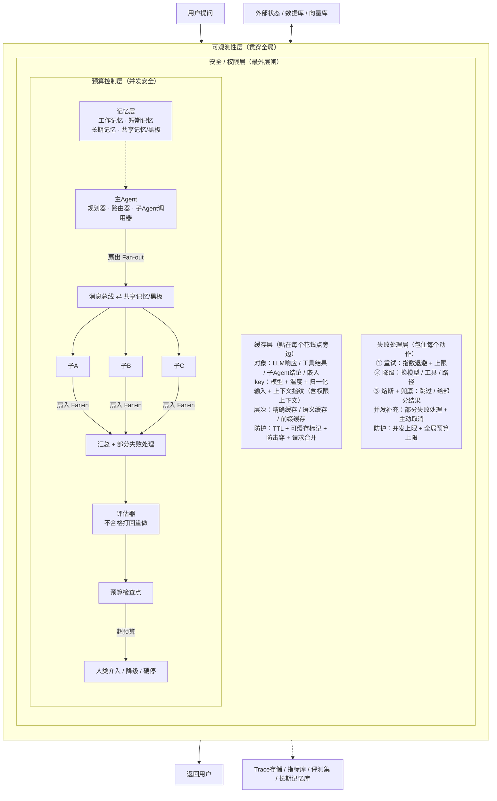

# agent项目结构组成


> 网页版（浏览器打开，可缩放）见同目录 `Agent结构总图.html`，位图版见 `Agent结构总图.png`。
> **两套颜色各管一件事，互不干扰**：包裹层颜色＝嵌套深浅——**紫（可观测性）⊃ 玫红（安全/权限）⊃ 青绿（预算控制）**，由外到内；格子颜色＝档位，与 `RAG 项目六层总图.md` 那张一致（绿色实心圆 ●＝必需档，玫红菱形 ◆＝生产必需档，灰虚线空心圆 ○＝进阶档）；白色卡片＝层内小节。
> 包裹关系与第一部分 ASCII 一致：可观测性 ⊃ 安全/权限 ⊃ 预算控制 ⊃（记忆层 + 主 Agent 编排流程），缓存层与失败处理层是安全层里包住动作的两个兄弟节点。
> 每层内容纵向排列、居中收窄，两侧留白正好露出包裹层的颜色。**必需档 5 项**（LLM / 工具 / 循环 / 提示词 / 工作记忆）在图里就是绿格子：4 项在主 Agent 的内核里，1 项是记忆层的"工作记忆"。
> **图最下方是一个独立区域「每个动作的执行顺序」**：输入检查 → 权限检查 → 查缓存 → 预算检查 → 执行（失败走三道防线）→ 输出检查 → 写缓存，三个阶段全部记入 Trace。
> 下面保留原有的 ASCII 版和 Mermaid 版，作为纯文本备份。

> **目录**
>
> - [第一部分：完整版结构图（每层带说明）](#第一部分完整版结构图每层带说明)
>   - [动作执行顺序](#动作执行顺序)
> - [第二部分：执行第 4 步——做减法](#第二部分执行第-4-步做减法)
>   - [先给所有图层分三档](#先给所有图层分三档)
>   - [逐层归类](#逐层归类)
>     - [必需档（缺了就不是 Agent）](#必需档缺了就不是-agent)
>     - [生产必需档（能跑但不敢上线）](#生产必需档能跑但不敢上线)
>     - [进阶档（按需加，别一开始就上）](#进阶档按需加别一开始就上)
>   - [关键结论：大多数项目“加太多、加太早”](#关键结论大多数项目加太多加太早)
>   - [落地建议：分阶段加，别一步到位](#落地建议分阶段加别一步到位)
>   - [一句话总结](#一句话总结)
> - [附录：结构图（Mermaid 版）](#附录结构图mermaid-版)

---

## 第一部分：完整版结构图（每层带说明）

```text
                           用户提问
                              ↓
┌══════════════════ 可观测性层（贯穿全局） ══════════════════┐
│ ① 采集：每个动作埋点（Trace / Span / Log / Metric）        │
│ ② 查看：Trace树 + Dashboard + 搜索                         │
│ ③ 回放：按 trace 重跑 + 对比结果                           │
│ ④ 评测：离线测试集 + 打分器（规则/LLM裁判/人工）           │
│ ⑤ 归因：成本/延迟/错误 定位到具体 span                     │
│ 作用：从"能跑"到"能优化"的分水岭                           │
│                                                            │
│ ┌────────────── 安全 / 权限层（最外层闸） ───────────────┐ │
│ │ ① 输入检查：防提示词注入（标记外部内容为数据）         │ │
│ │ ② 工具权限检查：白名单 + 参数校验 + 审批               │ │
│ │ ③ 输出检查：防泄露（扫 PII / 密钥 / 内部数据）         │ │
│ │ ④ 能力隔离：沙箱 + 最小权限 + 数据分级                 │ │
│ │ 核心原则：权限只能收窄不能放大                         │ │
│ │                                                        │ │
│ │ ┌────────────── 预算控制层（并发安全） ──────────────┐ │ │
│ │ │ ① 三个计数器：Token / 调用 / 步骤                  │ │ │
│ │ │ ② 检查点：每次花钱前必过                           │ │ │
│ │ │ ③ 分层配额：总/主/子Agent/单工具                   │ │ │
│ │ │ ④ 超标处理：硬停/降级/求助/兜底                    │ │ │
│ │ │ 特性：原子扣减 + 预分配 + 全局上限                 │ │ │
│ │ │                                                    │ │ │
│ │ │ ┌──────────────────── 记忆层 ────────────────────┐ │ │ │
│ │ │ │ 工作记忆：当前任务临时状态                     │ │ │ │
│ │ │ │   （快、小、用完即弃，每Agent独立）            │ │ │ │
│ │ │ │ 短期记忆：会话历史                             │ │ │ │
│ │ │ │   （滑动窗口/摘要/重要度筛选，防撑爆上下文）   │ │ │ │
│ │ │ │ 长期记忆：跨会话事实/偏好                      │ │ │ │
│ │ │ │   （向量库+知识图谱，写入判断+语义检索）       │ │ │ │
│ │ │ │ 共享记忆/黑板：公共白板                        │ │ │ │
│ │ │ │   （加锁，防写冲突）                           │ │ │ │
│ │ │ └────────────────────────────────────────────────┘ │ │ │
│ │ │                                                    │ │ │
│ │ │    主Agent                                         │ │ │
│ │ │      ├─ 规划器：拆任务成步骤                       │ │ │
│ │ │      ├─ 路由器：判断派给哪个子Agent                │ │ │
│ │ │      └─ 子Agent调用器                              │ │ │
│ │ │           ↓ 扇出 Fan-out                           │ │ │
│ │ │      [消息总线] ←→ [共享记忆/黑板]                 │ │ │
│ │ │        ↙    ↓    ↘                                 │ │ │
│ │ │     子A    子B    子C                              │ │ │
│ │ │      ↑各自独立LLM+工具+记忆+循环                   │ │ │
│ │ │        ↘    ↓    ↙                                 │ │ │
│ │ │           ↓ 扇入 Fan-in                            │ │ │
│ │ │         [汇总 + 部分失败处理]                      │ │ │
│ │ │           ↓                                        │ │ │
│ │ │     [评估器] ── 不合格打回重做                     │ │ │
│ │ │           ↓                                        │ │ │
│ │ │     [预算检查点]                                   │ │ │
│ │ │        ↓ 超预算                                    │ │ │
│ │ │     [人类介入 / 降级 / 硬停]                       │ │ │
│ │ └────────────────────────────────────────────────────┘ │ │
│ │                                                        │ │
│ │ ┌─────────── 缓存层（贴在每个花钱点旁边） ───────────┐ │ │
│ │ │ 对象：LLM响应/工具结果/子Agent结论/嵌入            │ │ │
│ │ │ key：模型+温度+归一化输入+上下文指纹               │ │ │
│ │ │   （含权限上下文）                                 │ │ │
│ │ │ 层次：精确缓存 / 语义缓存 / 前缀缓存               │ │ │
│ │ │ 防护：TTL + 可缓存标记 + 防击穿                    │ │ │
│ │ │   + 请求合并                                       │ │ │
│ │ └────────────────────────────────────────────────────┘ │ │
│ │                                                        │ │
│ │ ┌──────────── 失败处理层（包住每个动作） ────────────┐ │ │
│ │ │ ① 重试：指数退避 + 上限                            │ │ │
│ │ │ ② 降级：换模型/工具/路径                           │ │ │
│ │ │ ③ 熔断+兜底：跳过/给部分结果                       │ │ │
│ │ │ 并发补充：部分失败处理 + 主动取消                  │ │ │
│ │ │ 防护：并发上限 + 全局预算上限                      │ │ │
│ │ └────────────────────────────────────────────────────┘ │ │
│ │                                                        │ │
│ └────────────────────────────────────────────────────────┘ │
│                                                            │
└════════════════════════════════════════════════════════════┘
   ↓                                              ↑
返回用户                                外部状态/数据库/向量库
                              ↑
          [Trace存储 / 指标库 / 评测集 / 长期记忆库]
```

### 动作执行顺序

```text
输入检查 → 权限检查 → 查缓存 → 预算检查 → 执行（失败走三道防线） → 输出检查 → 写缓存
  安全       安全      省钱      省钱                                安全
└───────────────────────────────── 全部记入 Trace ─────────────────────────────────┘
```

---

## 第二部分：执行第 4 步——做减法

一路加下来，这张图已经很"重"了。现在回头问一个最关键的问题：

> **哪些是"没有就跑不起来"的，哪些是"没有也能跑，只是不够好"的？**

---

### 先给所有图层分三档

| 档位         | 含义                   | 判断标准                   |
| :----------- | :--------------------- | :------------------------- |
| **必需**     | 没有它就不是 Agent     | 缺了功能不成立             |
| **生产必需** | 能跑但不敢上线         | 缺了会出事（烧钱/崩/闯祸） |
| **进阶**     | 没有也能跑，只是不够好 | 优化项，按需加             |

---

### 逐层归类

#### 必需档（缺了就不是 Agent）

| 层              | 为什么必需                              |
| :-------------- | :-------------------------------------- |
| **LLM（大脑）** | 没有它不会思考                          |
| **工具**        | 没有它不能做事，只能聊天                |
| **循环**        | 没有它不会自主决策（这是 Agent 的本质） |
| **提示词**      | 没有它 LLM 不知道规则                   |
| **工作记忆**    | 没有它循环每步失忆                      |

**最小 Agent = LLM + 工具 + 循环 + 提示词 + 工作记忆。**

#### 生产必需档（能跑但不敢上线）

| 层                        | 缺了会怎样           |
| :------------------------ | :------------------- |
| **预算控制**              | 烧钱失控             |
| **失败处理**              | 一挂就崩             |
| **安全/权限**             | 闯祸、被注入         |
| **可观测性（采集+查看）** | 出事查不到，没法运维 |
| **持久化**                | 重启全丢             |

**能上线的 Agent = 最小 Agent + 这五样。**

#### 进阶档（按需加，别一开始就上）

| 层                                 | 什么时候才需要            |
| :--------------------------------- | :------------------------ |
| **子 Agent**                       | 任务复杂、需要专业化/隔离 |
| **路由 / 规划器**                  | 任务多步骤、多类型        |
| **共享记忆 / 消息总线**            | 多个 Agent 要协作         |
| **评估器**                         | 质量要求高、要自我纠错    |
| **人类介入**                       | 高风险决策                |
| **缓存**                           | 调用量大、重复多、要省钱  |
| **并行**                           | 任务独立、要提速          |
| **长期记忆 / 向量 / 图谱**         | 要跨会话、要知识积累      |
| **可观测性（回放+评测）**          | 要持续优化                |
| **动态编排 / 层级嵌套 / 学习进化** | 超大规模、要自适应        |

---

### 关键结论：大多数项目"加太多、加太早"

一路加下来很爽，但真实情况是：

```text
80% 的项目，用【最小 Agent + 生产五件套】就够了
15% 的项目，加【子Agent + 路由 + 缓存】就够
5% 的项目，才需要后面那些
```

**最大的坑不是"缺功能"，而是"过早复杂"**：

- 加了子 Agent，上下文隔离没做好，反而更乱
- 加了并行，预算和状态没管好，直接爆炸
- 加了长期记忆，污染了，越用越错

**复杂度是有成本的**——每一层都要维护、调试、付钱。

---

### 落地建议：分阶段加，别一步到位

```text
阶段1：最小 Agent
  LLM + 工具 + 循环 + 提示词 + 工作记忆
  → 先让它能跑

阶段2：生产五件套
  + 预算 + 失败处理 + 安全 + 可观测性(采集) + 持久化
  → 先让它敢上线

阶段3：按痛点加
  任务复杂 → 加子Agent + 路由 + 规划
  太慢太贵 → 加缓存 + 并行
  质量不稳 → 加评估器
  要跨会话 → 加长期记忆
  → 缺什么补什么

阶段4：规模化
  动态编排 / 层级嵌套 / 学习进化
  → 到这一步说明你已经是少数派了
```

---

### 一句话总结

> **最小 Agent = LLM + 工具 + 循环 + 提示词 + 工作记忆。**
>
> **能上线 = 最小 + 预算 + 失败处理 + 安全 + 可观测性 + 持久化。**
>
> **其余全是进阶项，按痛点加，别提前上。**
>
> **80% 的项目死于"加太多"，不是"加太少"。**

---

## 附录：结构图（Mermaid 版）


