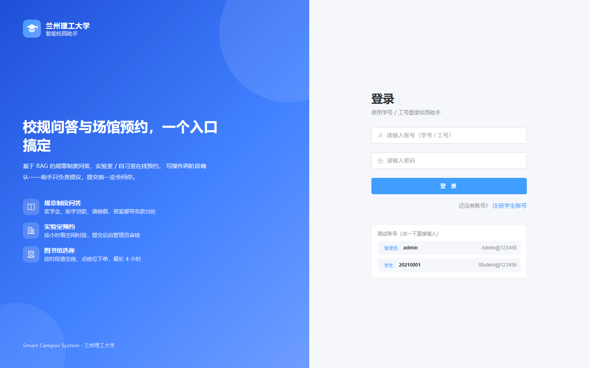
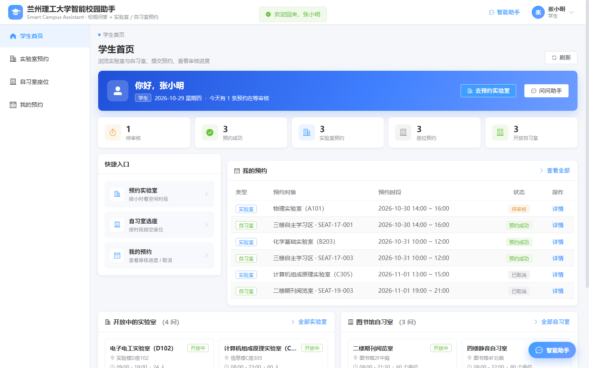
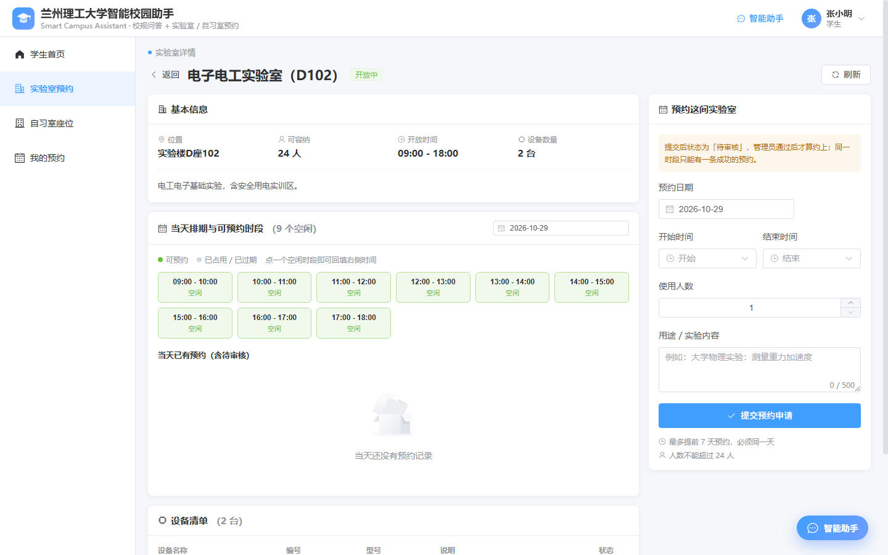
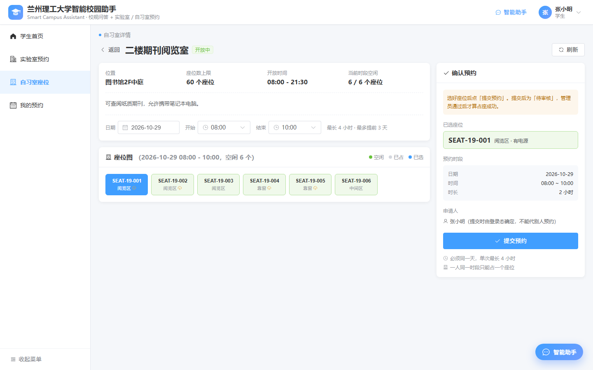
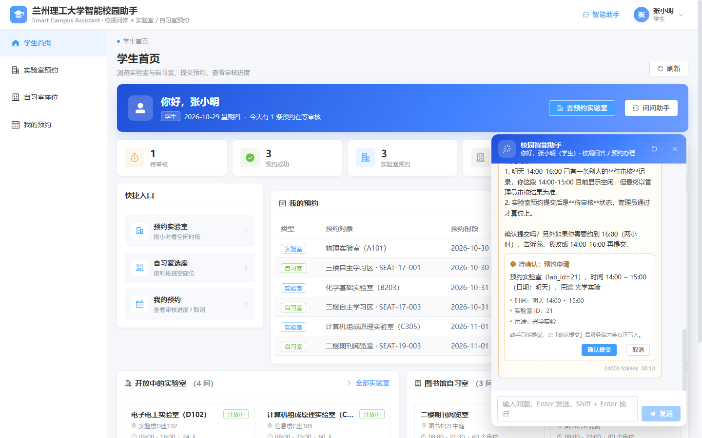
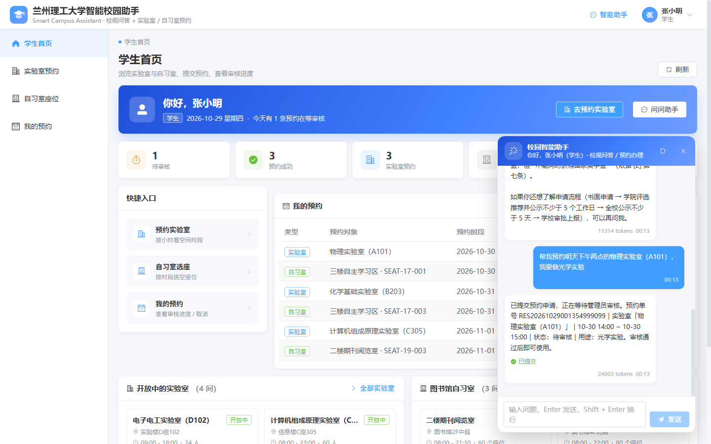
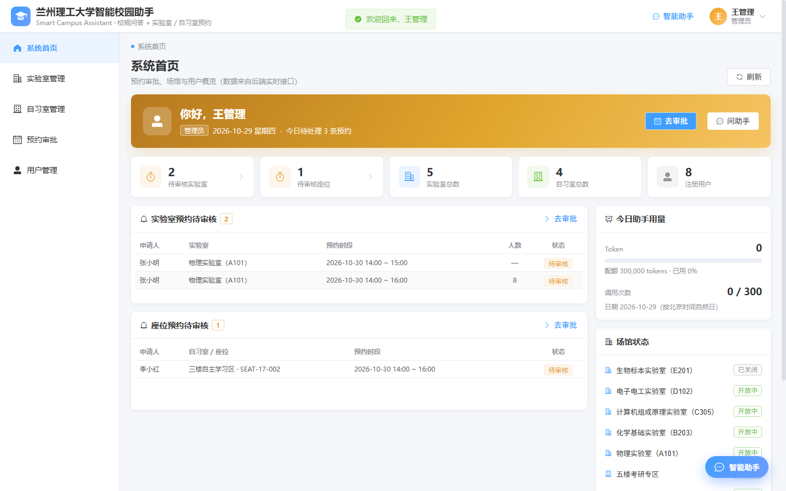
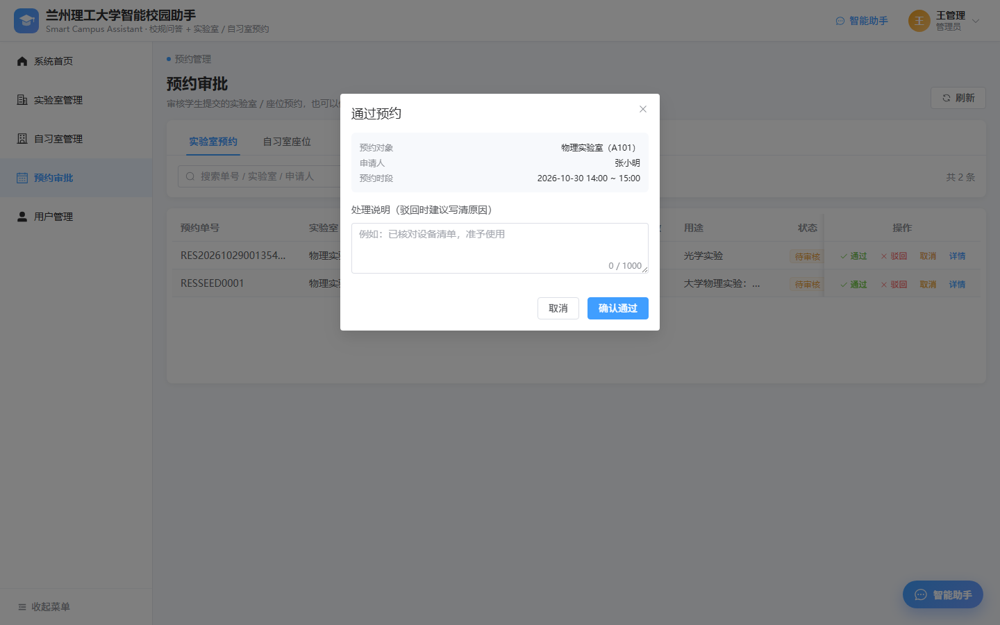
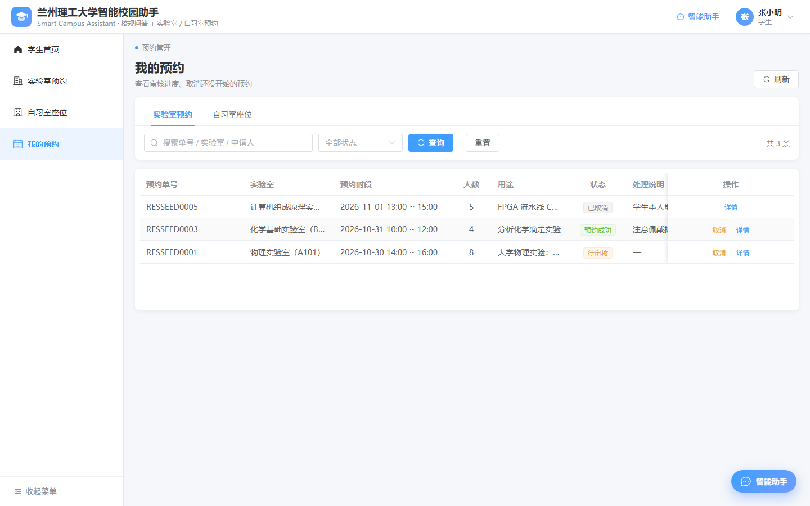
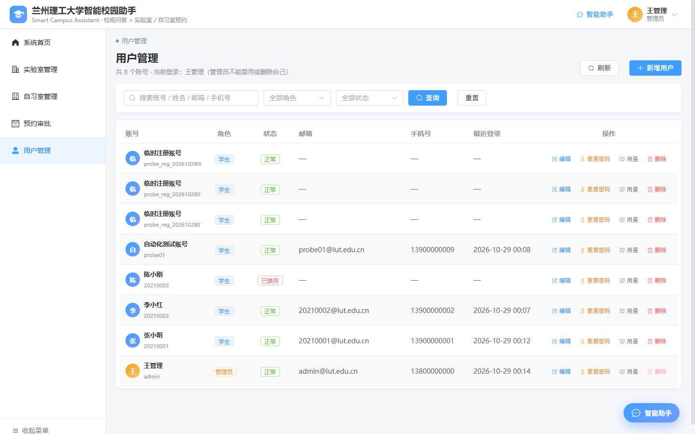

# 兰州理工大学智能校园助手 · 前端

后端在仓库根目录（FastAPI + LangGraph + Milvus + MySQL），这里只放 Web 界面。

- **技术栈**：Vue 3（`<script setup>` + TypeScript）+ Vite + Element Plus + vue-router + axios
- **登录态**：JWT 存在 `localStorage`，请求统一带 `Authorization: Bearer <token>`
- **角色**：`student`（学生）与 `admin`（管理员），菜单与首页按角色切换
- **智能助手**：常驻右下角，支持校规问答与「预约 → 待确认 → 确认提交」两阶段写操作

> 界面风格与工程结构参考了 `Laboratory-Reservation/frontend`，但接口契约、
> 页面与业务规则全部按本项目（SmartCampusSystem）重写。

## 界面预览

截图来自真实运行（后端 8000 + 前端 5173 + 种子数据）。

| 登录 | 学生首页 |
|---|---|
|  |  |

| 实验室详情（选时段） | 自习室选座 |
|---|---|
|  |  |

| 智能助手：待确认卡片 | 确认后回执 |
|---|---|
|  |  |

| 管理员首页 | 预约审批 |
|---|---|
|  |  |

| 我的预约 | 用户管理 |
|---|---|
|  |  |

---

## 一、跑起来

### 1. 先起后端

```powershell
# 仓库根目录
.\.venv\Scripts\uvicorn.exe app.main:app --host 127.0.0.1 --port 8000
```

没数据先灌一遍种子（账号 / 实验室 / 自习室 / 预约）：

```powershell
.\.venv\Scripts\python.exe scripts\seed_test_data.py
```

### 2. 起前端

```powershell
cd frontend
npm install          # 首次；node >= 22.18 或 >= 24.12
npm run dev          # http://localhost:5173
```

打开 <http://localhost:5173>，用种子账号登录：

| 账号 | 密码 | 角色 |
|---|---|---|
| `admin` | `Admin@123456` | 管理员 |
| `20210001` | `Student@123456` | 学生（张小明） |
| `20210002` | `Student@123456` | 学生（李小红） |

登录页上也放了「点一下直接填入」的测试账号块。

### 3. 生产构建与预览

```powershell
npm run build        # 类型检查（vue-tsc）+ 打包到 dist/
npm run preview      # vite 自带的预览
```

如果环境里起不了 vite 的预览（比如带文件沙箱的 CI），用仓库自带的纯标准库预览脚本：

```powershell
python scripts\serve_dist.py --port 5173
```

它做三件事：发 `dist` 静态文件、把 `/api` 与 `/static` 反向代理到后端、
其余路径回 `index.html`（SPA 刷新不 404）。

---

## 二、环境变量

| 文件 | 变量 | 值 | 说明 |
|---|---|---|---|
| `.env.development` | `VITE_API_BASE_URL` | 空 | 走 `vite.config.ts` 里的 `/api`、`/static` 代理（默认 8000） |
| `.env.production` | `VITE_API_BASE_URL` | 空 | 同源部署：由 nginx / Caddy / `serve_dist.py` 把 `/api` 转给后端 |

想让前端直连别的后端（例如 `http://127.0.0.1:9000`），把变量改成完整地址，
并确认后端 `.env` 的 `CORS_ORIGINS` 里有前端域名。

开发代理配置在 `vite.config.ts`：

```ts
server: {
  port: 5173,
  proxy: {
    '/api': { target: 'http://127.0.0.1:8000', changeOrigin: true },
    '/static': { target: 'http://127.0.0.1:8000', changeOrigin: true }
  }
}
```

---

## 三、目录结构

```
frontend/
├─ index.html
├─ vite.config.ts            开发端口 5173 + /api、/static 代理
├─ tsconfig*.json
├─ .env.development          开发：同源代理
├─ .env.production           生产：同源部署
├─ scripts/
│  └─ serve_dist.py          无依赖静态预览（含 /api 代理）
└─ src/
   ├─ main.ts                挂载 App / 路由 / Element Plus（中文语言包）
   ├─ App.vue
   ├─ router/index.ts        路由表 + 登录与角色守卫
   ├─ layouts/Layout.vue     顶栏（品牌 / 助手入口 / 用户菜单）+ 侧边菜单 + 内容区
   ├─ api/                   一个后端文件对应一个模块
   │  ├─ auth.ts             /api/auth/*
   │  ├─ chat.ts             /api/chat*
   │  ├─ lab.ts              /api/labs*、/api/equipments*
   │  ├─ room.ts             /api/rooms*、/api/seats*
   │  ├─ reservation.ts      我的预约 + 管理员审核
   │  └─ user.ts             /api/users*
   ├─ schemas/               与后端 Pydantic 模型一一对应的 TS 类型
   │  ├─ api.ts              {code,message,data} 信封 + 分页
   │  ├─ user.ts lab.ts room.ts reservation.ts chat.ts
   │  └─ axios.d.ts          让 request(...) 直接返回信封
   ├─ utils/
   │  ├─ request.ts          axios 实例：JWT、信封解包、401 登出、422 字段级提示
   │  ├─ auth.ts user.ts     本地登录态 + 响应式当前用户
   │  ├─ role.ts             角色 → 首页 / 权限前缀
   │  ├─ dict.ts             状态码 → 文案 / 标签颜色（实验室、座位、预约、用户）
   │  ├─ format.ts           时间、时段、容量、静态资源地址
   │  └─ chatStore.ts        助手会话状态（发送 / 历史 / 确认 / 清空）
   ├─ components/
   │  ├─ AgentChat.vue       悬浮对话窗（含两阶段确认卡片）
   │  ├─ LabFormDialog.vue   新增 / 编辑实验室
   │  └─ RoomFormDialog.vue  新增 / 编辑自习室
   ├─ views/
   │  ├─ Login.vue Register.vue Profile.vue
   │  ├─ Lab.vue LabDetail.vue
   │  ├─ Room.vue RoomDetail.vue
   │  ├─ Reservations.vue    学生「我的预约」/ 管理员「预约审批」
   │  ├─ Users.vue           用户管理（管理员）
   │  └─ home/StudentHome.vue home/AdminHome.vue
   └─ assets/                global.css、logo.svg
```

---

## 四、页面与接口对照

| 路由 | 页面 | 角色 | 主要接口 |
|---|---|---|---|
| `/login` `/register` | 登录 / 注册 | 游客 | `POST /api/auth/login`、`POST /api/auth/register` |
| `/manager/student` | 学生首页 | 学生 | `GET /api/reservations/mine/summary`、`/lab/mine`、`/library/mine`、`/api/labs`、`/api/rooms` |
| `/manager/home` | 管理员首页 | 管理员 | `GET /api/admin/reservations/{lab,library}`、`/api/labs`、`/api/rooms`、`/api/users`、`/api/admin/usage/{id}` |
| `/manager/lab` | 实验室列表 / 管理 | 两者 | `GET /api/labs`、`POST/PUT/DELETE /api/labs` |
| `/manager/lab/:id` | 实验室详情 + 预约 | 两者 | `GET /api/labs/{id}/schedule`、`/equipments`、`POST /api/reservations/lab`、设备增删改 |
| `/manager/room` | 自习室列表 / 管理 | 两者 | `GET /api/rooms`、`POST/PUT/DELETE /api/rooms` |
| `/manager/room/:id` | 自习室选座 + 预约 | 两者 | `GET /api/rooms/{id}/seats?start_time&end_time`、`POST /api/reservations/library`、座位增删改 |
| `/manager/reservations` | 我的预约 / 预约审批 | 两者 | `GET /api/reservations/*/mine`、`GET /api/admin/reservations/*`、审核 / 取消 |
| `/manager/users` | 用户管理 | 管理员 | `GET/POST/PUT/DELETE /api/users*`、`/api/admin/usage/{id}` |
| `/manager/profile` | 个人中心 | 两者 | `GET /api/auth/me`、`PUT /api/auth/profile`、`PUT /api/auth/password` |
| 全局悬浮窗 | 智能助手 | 两者 | `POST /api/chat`、`POST /api/chat/confirm`、`GET /api/chat/history`、`DELETE /api/chat/thread` |

路由守卫（`src/router/index.ts`）做三件事：

1. 没 token → `/login?redirect=...`；
2. `requiresAdmin` 页面非管理员 → 回自己的首页（`ElMessage.warning`）；
3. `requiresStudent` 页面管理员访问 → 回管理员首页。

真正的权限在后端：所有写接口都挂 `require_admin`，前端只决定「显示哪些按钮」。

---

## 五、两阶段确认（这个项目的关键交互）

后端约定（`app/api/chat.py`）：

```
POST /api/chat
  → status = "ok"           直接回答
  → status = "need_confirm" 回答里是「待确认」，预约**还没有提交**
        ↓ 学生点「确认提交」
POST /api/chat/confirm {thread_id, tool_call_id, approve, action?}
  → status = "approved"     服务端才真正落库
```

前端在 `components/AgentChat.vue` 里把 `pending_actions` 渲染成卡片：

- 卡片标题：`待确认：预约申请` / `待确认：取消预约`
- 正文：后端给的 `summary` + 从 `args` 里提取的时间 / 实验室 ID / 人数 / 用途
- 按钮：「确认提交」调 `confirm(approve=true)`，「取消」调 `confirm(approve=false)`
- 提交后卡片变成「已提交 / 已取消」，回执消息显示预约单号

`action` 是**兜底回放**：把实时响应里的 `tool_name` + `args` 原样带回去，
即使 Milvus（会话记忆）不可用也能完成确认——实测本地 Milvus 记忆为空时，
这条路径依然能把预约落库。

---

## 六、和参考项目的对应关系

| 参考项目（Laboratory-Reservation） | 本项目 |
|---|---|
| `views/Login.vue` / `Register.vue` | 同样拆成两个独立页面，改为校园账号体系 |
| `layouts/Layout.vue` 双首页（管理员 / 学生） | 保留，菜单改为「实验室 / 自习室 / 预约 / 用户」 |
| `views/Subscribe.vue` 待处理 / 已处理 | `Reservations.vue` 用「实验室 / 自习室」页签 + 状态筛选，审核弹窗保留 |
| `components/AgentChat.vue` 悬浮聊天 | 保留悬浮形态，新增**确认卡片**（本项目有写操作闸门） |
| `views/LabDetail.vue` 预约表单 | 改为「可预约时段网格 + 起止时间」，时段数据来自 `/schedule` |
| `views/Equipment.vue` 独立设备页 | 合并进实验室详情（设备清单 + 管理员增删改），少一个一级菜单 |
| `utils/dict.ts` 状态字典 | 沿用，状态取值按本项目的 table.py 重写 |
| `utils/request.ts` 信封拦截器 | 沿用，新增 422 字段级错误提示 |

---

## 七、几个坑（都已在代码里处理）

1. **数组查询参数**：FastAPI 的 `list[int]` 需要 `status=0&status=1`，
   axios 默认生成 `status[]=0`，所以 `request.ts` 里配了 `paramsSerializer: { indexes: null }`。
2. **422 提示**：后端信封只有「请求参数校验错误」，真正的字段原因在 `data[0].loc/msg`，
   `pickErrorMessage` 会拼成「…（password: 密码不能超过 72 字节）」。
3. **登录接口的 401**：账号密码错误也是 401，不能当成登录态失效去强制登出，
   拦截器里用 `isLoginRequest` 区分。
4. **时段返回的是完整时间**：`/api/labs/{id}/schedule` 的 `TimeSlot.start_time` 是
   `2026-10-29T09:00:00`，显示与回填要用 `timeOfDay()`（只取 `HH:mm`），
   不能用 `formatTime()`（那是给 `08:00:00` 这种纯时间用的）。
5. **种子图片**：种子里的 `/static/labs/*.jpg` 本地没有对应文件（后端没挂静态目录），
   卡片会走 `el-image` 的 error 插槽显示渐变占位，控制台会有 404，属正常现象。
6. **Milvus 不可用**：`/api/chat/history` 返回空、对话仍可用（后端 fail-open），
   前端打开聊天窗时只显示欢迎语，不会白屏。

---

## 八、可选：一键验收

仓库根目录的 `scripts/smoke_test_web_api.py` 覆盖了前端用到的全部接口（58 条断言）：

```powershell
.\.venv\Scripts\python.exe scripts\smoke_test_web_api.py
```

前端自身没有引入单元测试框架；类型与构建检查用：

```powershell
npm run type-check   # vue-tsc --build
npm run build-only   # vite build
```
